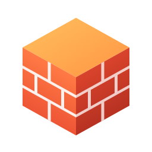

<p align="center"></p>
<h1 align="center" style="border-bottom: none;">CasWAF</h1>
<h3 align="center">An open-source Web Application Firewall (WAF) software developed by Go and React.</h3>
<p align="center">
  <a href="#badge">
    
  </a>
  <a href="https://hub.docker.com/r/casbin/caswaf">
    
  </a>
  <a href="https://github.com/caswaf/caswaf/releases/latest">
    
  </a>
  <a href="https://hub.docker.com/r/casbin/caswaf">
    
  </a>
</p>

<p align="center">
  <a href="https://goreportcard.com/report/github.com/caswaf/caswaf">
    
  </a>
  <a href="https://github.com/caswaf/caswaf/blob/master/LICENSE">
    
  </a>
  <a href="https://github.com/caswaf/caswaf/issues">
    
  </a>
  <a href="#">
    
  </a>
  <a href="https://github.com/caswaf/caswaf/network">
    
  </a>
</p>

## Documentation

https://caswaf.org

## Architecture

CasWAF contains 2 parts:

| Name     | Description                    | Language               | Source code                                      |
|----------|--------------------------------|------------------------|--------------------------------------------------|
| Frontend | Web frontend UI for CasWAF     | Javascript + React     | https://github.com/caswaf/caswaf/tree/master/web |
| Backend  | RESTful API backend for CasWAF | Golang + Beego + MySQL | https://github.com/caswaf/caswaf                 |

## Installation

CasWAF uses Casdoor to sign in to its console. So you need to create an organization and an application for CasWAF in a Casdoor instance. Only the administrators of that organization (`isAdmin` in Casdoor) can manage CasWAF.

### Deployment Options

- **[Kubernetes Deployment](k8s/README.md)**: Deploy CasWAF on Kubernetes with complete manifests and guide
- **Docker Compose**: Use the provided `docker-compose.yml` for quick local setup
- **Manual Installation**: Build and run from source

See the [quick start](https://caswaf.org/en/docs/getting-started/quickstart) for the full steps.

### Necessary configuration

#### Get the code

```shell
git clone https://github.com/caswaf/caswaf
```

#### Setup database

CasWAF stores its sites, certificates, rules, nodes and request records in a MySQL database named `caswaf`. Create the database first, or start CasWAF once with `-createDatabase=true` to create it. The DB connection string can be specified at: https://github.com/caswaf/caswaf/blob/master/conf/app.conf

```ini
dataSourceName = root:123@tcp(localhost:3306)/
```

CasWAF uses XORM to connect to DB, so all DBs supported by XORM can also be used.

#### Configure Casdoor

After creating an organization and an application for CasWAF in a Casdoor, update `casdoorEndpoint`, `clientId`, `clientSecret`, `casdoorOrganization` and `casdoorApplication` in `conf/app.conf`, and the same values in `web/src/Conf.js`. Add `http://localhost:17000/callback` to the application's redirect URLs.

#### Run CasWAF

```shell
cd web && yarn install && yarn build && cd ..
go build -o caswaf . && sudo ./caswaf
```

- Open browser: http://localhost:17000/
- The gateway listens on ports 80 and 443. CasWAF stops whatever process holds ports 80, 443 and 17000 when it starts.

### Optional configuration

#### Setup your WAF to enable some third-party login platform

CasWAF uses Casdoor to manage members. If you want to log in with oauth, you should see [casdoor oauth configuration](https://casdoor.ai/docs/provider/oauth/overview).

#### OSS, Mail, and SMS services

CasWAF uses Casdoor to send health alert emails and SMSs. See Casdoor for more details.

## Contribute

For CasWAF, if you have any questions, you can open Issues, or you can also directly start Pull Requests(but we recommend opening issues first to communicate with the community).

## License

[Apache-2.0](https://github.com/caswaf/caswaf/blob/master/LICENSE)
